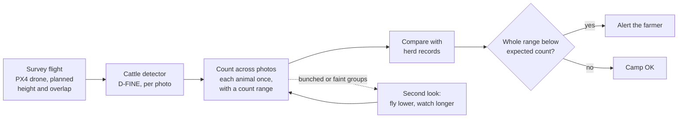
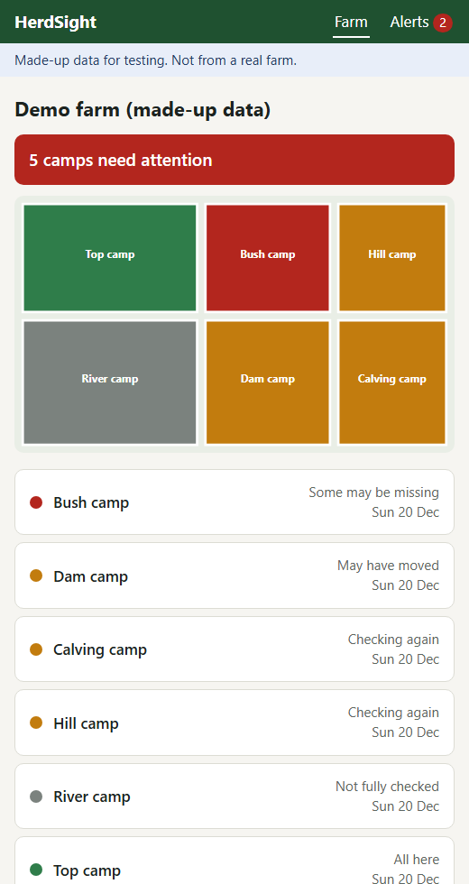
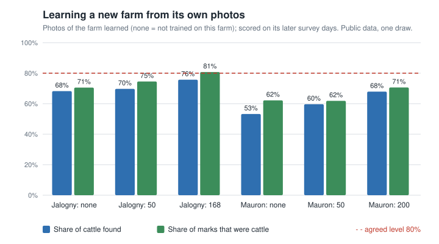

# HerdSight

HerdSight counts cattle from the air and tells a farmer when animals may be missing.

A drone surveys each camp (paddock). The software counts the cattle in the photos, making sure an animal seen in several photos is counted once, and compares the total with the farm's herd records. It raises an alert only when the shortfall is clear enough to act on. The aim is to help farmers notice stock theft and straying early.

> **Status: work in progress, about 80% of planned tasks complete.**
> HerdSight has not been flown on a real farm. Every result below comes from public drone data or from simulation, and each one says which. None is a field result.

---

## How it works



| Part | What it does | Where |
|---|---|---|
| Detector | Finds cattle in each drone photo | `gpu/`, `python/herdsight/detect/` |
| Counting | Links the same animal across overlapping photos and gives each flight a count range | `python/herdsight/count/`, `core/` (C++) |
| Herd records and alerts | Tracks expected animals per camp and decides when to alert | `python/herdsight/` |
| Drone mission | Plans and flies the survey with safety checks, in PX4 and Gazebo simulation | `ros2/`, `sim/` |
| Farmer dashboard | Shows results in plain language on a phone (working prototype) | `dashboard/`, `python/herdsight/dashboard/` |

## Progress

| Phase | | Status |
|---|---|---|
| 0 | Setup: code structure, automated checks, C++ core | Done |
| 1 | Data audit, fair splits, baselines, frozen targets | Done |
| 2 | Cattle detector | Mostly done; onboard detector chosen; learning a new farm from its own photos improves results, but levels off below the agreed 80% |
| 3 | Counting across photos | Done; rerun with the final detector: 25% whole-flight error against the 15% target |
| 4 | Herd records and alerts | Done; refitted with the final accuracy and tested once on held-back simulated farms: target not met |
| 5 | Simulated drone mission | 16 of 16 overnight simulated missions passed their checks; GPS-loss return works up to 5 m/s wind |
| 6 | Farmer dashboard | Prototype built; usability test with five people next |
| 7 | Final test on the held-back farm, and write-up | Test farm and simulated test sets run once each: detection, counting and alert targets not met (see 8 below); write-up in progress |

## Results so far

### 1. Finding cattle in a photo (public data)


The detector is trained and scored on the public ICAERUS drone dataset: 1,323 photos and 3,392 cattle from three French farms. Tested on survey days held out from training, it finds 73% of the cattle. On a farm it never saw in training, it finds 55%.

That drop is the biggest accuracy problem in the project. Most of the animals it misses on a new farm have dark coats or stand in tight groups. I tried two training changes aimed at this, harder augmentation and then darker coats with tight groups, and neither beat the reference model on unseen farms (`docs/decisions.md`, D-49 and D-50). A second look, where the drone flies lower over uncertain groups and watches them for longer, did no better than the simpler herd mode in simulation. Teaching the detector each new farm helped more (section 7).

### 2. Counting a whole flight (public data)


These are 20 flights whose true counts I checked by hand. Adding up the animals in every photo overcounts by about 250%, because the same animals appear in many photos. Matching animals between photos by aligning the images brings the error down to 27%. Given perfect detections, the same method gets to 14%, inside the 15% target. The counting method works; the detector is what holds it back.

### 3. Deciding when to alert (simulation)


Each count comes with a range, and HerdSight alerts only when the whole range sits below the expected herd size. I tested several alert rules on 4,000 simulated farms with losses, moves and record errors, measuring false alarms against losses caught for each. At the final detector's count error, no rule meets the target. I then ran 4,000 separate simulated farms once, held back for this test: the standard rule raised 1.6 false alarms per 100 surveys and caught 46% of losses of five or more animals, against a target of at most 1.5 and at least 65%. With counting at its target accuracy the same farms give 1.2 false alarms and 64%, just short. Good alerts depend on better counting more than on a cleverer rule.

### 4. Returning home after GPS loss (simulation)


If a drone loses GPS, the autopilot has no position and descends "blind", and the wind carries it off. In simulation that put it about 200 m from the launch point in calm air and 900 m away in a 5 m/s wind. To avoid this, HerdSight keeps reference frames from its downward camera while GPS is working. After GPS is lost, it matches each live frame to those references and passes the resulting position to the autopilot, which can then fly home.


In calm air the drone landed 0.2 m from the launch point. In a 5 m/s wind it landed 7 m away, but its position errors on the way home went over the limits I set before the test, so I count that flight as a fail. In a 10 m/s wind the method does not work reliably yet.

### 5. Counting at night with a thermal camera (simulation)


This is a simulated thermal camera at night, with patches of warmer and cooler ground, blur and sensor noise added. At 40 m, counting the warm shapes comes within 5% of the true count, an average of 0.5 animals off per frame. With warm rocks added it stays inside the 10% limit. The simulated animals are simple blocks at fixed temperatures, so this shows the approach can work. It says nothing yet about accuracy on real animals.

### 6. The farmer's dashboard (prototype, made-up data)

<p>
  
  
</p>

A phone-first page that says in one line whether any camp needs attention, colours a map of the camps, and lists the
ones to look at first. Each camp shows its count, the likely range and the number in the records, with the plain-language
message and large buttons to act on an alert. It keeps working on a weak signal: the last results stay on the phone and
actions are sent when the signal returns. Simulated drone flights already flow from the mission to the count to this
page. The pictures use a made-up farm, and the page says so.

### 7. Learning a new farm from its own photos (public data)



The detector does worse on a farm it has never seen. So the plan is to start from the general model and teach it each new
farm using labelled photos from that farm's first surveys, then check it on the farm's later surveys. I tried this on two
public farms. On Jalogny, the share of cattle found went from 68% with none of its photos to 76% with 168. On Mauron,
scored in a different season, it went from 53% to 68% with 200 photos, and the counting error per tile dropped by almost
half. Results improved with more of the farm's photos on both farms, but neither reached the level I set before the
runs (80% found and 80% of marks correct), so I don't claim that level yet. Two farms and one random draw of photos is an
early indication, not a guarantee. Using all 447 of Mauron's photos did not help further (66% found, against 68%
with 200), so beyond a couple of hundred photos from the same days the gain stops. Photos from more days and seasons may
matter more than the number of photos; that is the next thing to test.

### 8. The final test on a farm held back from the start (public data)


One farm in the public data was set aside before any work began and never used for training or tuning. At the end I
froze the final models and settings, then scored that farm once: 62 photos with 1,355 cattle. The final detector found
69% of the cattle, and 74% of its marks were cattle, against targets of 80% for both. That is between how it did on
farms it had seen (73%) and on a farm left out of training (55%). It met 1 of the 9 targets I set before the work started. Crowding explains most of the misses: animals standing
within a body length of another were found 54% of the time, against 82% for animals standing apart, while their size
in the photo made almost no difference. Three quarters of the false marks sat next to a real animal, which points to
touching animals being split or merged.

Counting suffered most from how crowded the photos were. They hold about 22 cattle each, against about 3 in the photos
used for training, and the count was off by 2.2 animals per photo on average (target 0.45). On photos with 20 or more
animals that is under 5%, but the ranges I give for each count were fitted on sparse photos and held the true count
on only 79% of photos, against 85%. The small onboard model, meant to spot herds during the flight, found only 52% of the
herds on this farm, against 99% in earlier tests, because the animals stood close together. I report these as misses
and did not rerun the test. The fixes I would try first are count ranges that grow with the count and teaching the
detector each new farm (section 7).

## How the work is done

- Before each experiment I write down what I expect and what counts as a pass (`docs/hypotheses.md`). Results that miss are reported as misses.
- Each decision is logged with the options considered, the evidence, and the easier option I turned down. There are about 55 so far (`docs/decisions.md`).
- The targets were fixed before the main work began. One farm was held back, untouched, for a single final test in Phase 7, and was scored once.
- Scripts produce the headline numbers and figures from `results/` (for this page, `scripts/make_readme_figures.py`), and a test checks that every result number on this page traces back to them (`scripts/check_readme_numbers.py`).
- What the system cannot do is listed in `docs/limitations.md`.

## What comes next

1. Improve the detector on new farms: teach it each farm from photos spread across several days and seasons, which is where counting and alerts are held back. Ranges that only widen to cover the error were tried and are too wide to be useful (D-55).
2. Run the dashboard test with five people who are not technical.
3. Make the camera return reliable in wind (a stabilised camera is the likely fix).
4. Then trials with a real drone on real farms, set up farm by farm, with a clear go/no-go decision first.

## Repository layout

| Folder | What's in it |
|---|---|
| `docs/` | Decision log, hypotheses, data notes, open questions, limitations, figures, and one plan per piece of work (`docs/plans/`) |
| `configs/` | Settings, each with a cited source |
| `core/` | C++ library: geometry, matching, count intervals (with Python bindings) |
| `python/herdsight/` | Python package: data loading, detection, counting, alerts, evaluation, simulation tools |
| `ros2/` | ROS 2 packages that fly the mission |
| `sim/` | Gazebo worlds, cattle models, the herd movement model and simulated flight tools |
| `dashboard/` | Farmer dashboard (to be built) and its plain-language glossary |
| `scripts/` | Data inventory and splits, baselines, studies, freezing settings, filling docs from results |
| `gpu/` | Training and scoring jobs for cloud GPUs (Kaggle and rented GPUs) |
| `results/` | Machine-written results (never edited by hand) |
| `tests/` | Automated tests |

Datasets and model weights are not stored in this repository. `docs/data.md` explains where they come from.

## Development

Python 3.12 or later.

```bash
python -m venv .venv
.venv/bin/python -m pip install -r requirements-lock.txt   # Windows: .venv\Scripts\python
.venv/bin/python -m pip install -e . --no-deps
.venv/bin/pytest
```

The C++ core (`core/`) builds on Linux (Ubuntu 24.04, natively or in WSL) with CMake, Ninja, Eigen and GoogleTest:

```bash
sudo apt install build-essential cmake ninja-build libeigen3-dev libgtest-dev
scripts/build_core.sh            # sanitizer build + tests, then the Python module
HERDSIGHT_REQUIRE_CORE=1 pytest  # includes the C++/Python parity tests
```

The simulated mission runs in a Docker image with PX4, Gazebo and ROS 2 (`sim/docker/`). Large files (datasets, weights, run outputs) live outside the repository, in the folder named by the `HERDSIGHT_STORAGE` environment variable.

## Data and acknowledgements

- Drone cattle images: ICAERUS grazing cows v2, Institut de l'Elevage, Zenodo [10.5281/zenodo.11048412](https://doi.org/10.5281/zenodo.11048412) (CC BY 4.0).
- Simulated ground imagery: IGN BD ORTHO (Licence Ouverte / Etalab 2.0).
- Detector: D-FINE (Apache-2.0). The full register of models and weights is in `docs/licences.md`; data sources are in `docs/data.md`.

## Licence

Copyright (c) 2026 Luke Andrew. All rights reserved. See `LICENSE`.
