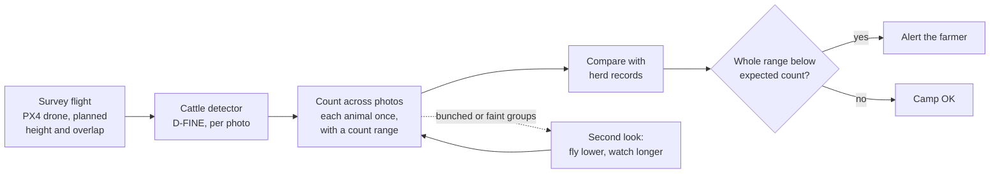
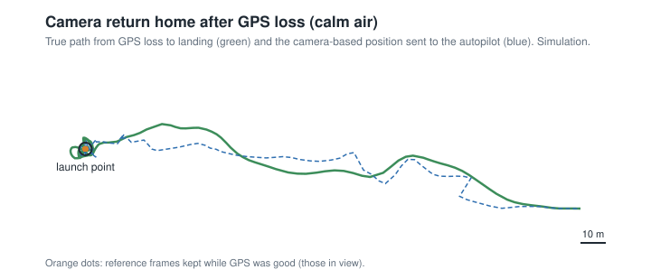

# HerdSight

HerdSight counts cattle from the air and tells a farmer when animals may be missing.

A drone surveys each camp (paddock). The software counts the cattle in the photos, making sure an animal seen in several photos is counted once, and compares the total with the farm's herd records. It raises an alert only when the shortfall is clear enough to act on. The aim is to help farmers notice stock theft and straying early.

> **Status: work in progress, about 55% of planned tasks complete.**
> HerdSight has not been flown on a real farm. Every result below comes from public drone data or from simulation, and each one says which. None is a field result.

---

## How it works



| Part | What it does | Where |
|---|---|---|
| Detector | Finds cattle in each drone photo | `gpu/`, `python/herdsight/detect/` |
| Counting | Links the same animal across overlapping photos and gives each flight a count range | `python/herdsight/count/`, `core/` (C++) |
| Herd records and alerts | Tracks expected animals per camp and decides when to alert | `python/herdsight/` |
| Drone mission | Plans and flies the survey with safety checks, in PX4 and Gazebo simulation | `ros2/`, `sim/` |
| Farmer dashboard | Shows results in plain language on a phone | `dashboard/` (not built yet) |

## Progress

| Phase | | Status |
|---|---|---|
| 0 | Setup: code structure, automated checks, C++ core | Done |
| 1 | Data audit, fair splits, baselines, frozen targets | Done |
| 2 | Cattle detector | Mostly done; the final onboard model is training |
| 3 | Counting across photos | Method chosen; to be rerun with the final detector |
| 4 | Herd records and alerts | Done; to be refitted with the final accuracy |
| 5 | Simulated drone mission | The mission and its safety checks fly; the GPS-loss return and night (thermal) counting are in progress |
| 6 | Farmer dashboard | Not started |
| 7 | Final test on the held-back farm, and write-up | Not started |

## Results so far

### 1. Finding cattle in a photo (public data)


The detector is trained and scored on the public ICAERUS drone dataset: 1,323 photos and 3,392 cattle from three French farms. Tested on survey days held out from training, it finds 73% of the cattle. On a farm it never saw in training, it finds 55%.

That drop is the biggest accuracy problem in the project. Most of the animals it misses on a new farm have dark coats or stand in tight groups. I tried two training changes aimed at this, harder augmentation and then darker coats with tight groups, and neither beat the reference model on unseen farms (`docs/decisions.md`, D-49 and D-50). The next step is a second look: the drone flies lower over uncertain groups and watches them for longer.

### 2. Counting a whole flight (public data)


These are 20 flights whose true counts I checked by hand. Adding up the animals in every photo overcounts by about 250%, because the same animals appear in many photos. Matching animals between photos by aligning the images brings the error down to 27%. Given perfect detections, the same method gets to 14%, inside the 15% target. The counting method works; the detector is what holds it back.

### 3. Deciding when to alert (simulation)


Each count comes with a range, and HerdSight alerts only when the whole range sits below the expected herd size. I tested several alert rules on 4,000 simulated farms with losses, moves and record errors, measuring false alarms against losses caught for each. At today's count error, no rule meets the target. At the target count error, a rule that uses each camp's survey history does.

### 4. Returning home after GPS loss (simulation)


If a drone loses GPS, the autopilot has no position and descends "blind", and the wind carries it off. In simulation that put it about 200 m from the launch point in calm air and 900 m away in a 5 m/s wind. To avoid this, HerdSight keeps reference frames from its downward camera while GPS is working. After GPS is lost, it matches each live frame to those references and passes the resulting position to the autopilot, which can then fly home.



In calm air the drone landed 0.2 m from the launch point. In a 5 m/s wind it landed 7 m away, but its position errors on the way home went over the limits I set before the test, so I count that flight as a fail. In a 10 m/s wind the method does not work reliably yet.

### 5. Counting at night with a thermal camera (simulation)


This is a simulated thermal camera at night, with patches of warmer and cooler ground, blur and sensor noise added. At 40 m, counting the warm shapes comes within 5% of the true count, an average of 0.5 animals off per frame. With warm rocks added it stays inside the 10% limit. The simulated animals are simple blocks at fixed temperatures, so this shows the approach can work. It says nothing yet about accuracy on real animals.

## How the work is done

- Before each experiment I write down what I expect and what counts as a pass (`docs/hypotheses.md`). Results that miss are reported as misses.
- Each decision is logged with the options considered, the evidence, and the easier option I turned down. There are about 50 so far (`docs/decisions.md`).
- The targets were fixed before the main work began. One farm is held back, untouched, for a single final test in Phase 7.
- Scripts produce the headline numbers and figures from `results/` (for this page, `scripts/make_readme_figures.py`). No number is typed in by hand.
- What the system cannot do is listed in `docs/limitations.md`.

## What comes next

1. Finish the onboard detector, choose the final model, and rerun counting and alerts with it.
2. Make the camera return reliable in wind, and finish the night (thermal) and second-look missions.
3. Run the mission tests automatically on every change, with a larger run every night.
4. Build the farmer dashboard and test it with five people who are not technical.
5. Freeze everything, run the held-back test farm once, and write up the results.
6. After that, trials with a real drone on real farms, with a clear go/no-go decision first.

## Repository layout

| Folder | What's in it |
|---|---|
| `docs/` | Decision log, hypotheses, data notes, open questions, limitations, figures, and one plan per piece of work (`docs/plans/`) |
| `configs/` | Settings, each with a cited source |
| `core/` | C++ library: geometry, matching, count intervals (with Python bindings) |
| `python/herdsight/` | Python package: data loading, detection, counting, alerts, evaluation, simulation tools |
| `ros2/` | ROS 2 packages that fly the mission |
| `sim/` | Gazebo worlds, cattle models, the herd movement model and simulated flight tools |
| `dashboard/` | Farmer dashboard (to be built) and its plain-language glossary |
| `scripts/` | Data inventory and splits, baselines, studies, freezing settings, filling docs from results |
| `gpu/` | Training and scoring jobs for cloud GPUs (Kaggle and rented GPUs) |
| `results/` | Machine-written results (never edited by hand) |
| `tests/` | Automated tests |

Datasets and model weights are not stored in this repository. `docs/data.md` explains where they come from.

## Development

Python 3.12 or later.

```bash
python -m venv .venv
.venv/bin/python -m pip install -r requirements-lock.txt   # Windows: .venv\Scripts\python
.venv/bin/python -m pip install -e . --no-deps
.venv/bin/pytest
```

The C++ core (`core/`) builds on Linux (Ubuntu 24.04, natively or in WSL) with CMake, Ninja, Eigen and GoogleTest:

```bash
sudo apt install build-essential cmake ninja-build libeigen3-dev libgtest-dev
scripts/build_core.sh            # sanitizer build + tests, then the Python module
HERDSIGHT_REQUIRE_CORE=1 pytest  # includes the C++/Python parity tests
```

The simulated mission runs in a Docker image with PX4, Gazebo and ROS 2 (`sim/docker/`). Large files (datasets, weights, run outputs) live outside the repository, in the folder named by the `HERDSIGHT_STORAGE` environment variable.

## Data and acknowledgements

- Drone cattle images: ICAERUS grazing cows v2, Institut de l'Elevage, Zenodo [10.5281/zenodo.11048412](https://doi.org/10.5281/zenodo.11048412) (CC BY 4.0).
- Simulated ground imagery: IGN BD ORTHO (Licence Ouverte / Etalab 2.0).
- Detector: D-FINE (Apache-2.0). The full register of models and weights is in `docs/licences.md`; data sources are in `docs/data.md`.

## Licence

Copyright (c) 2026 Luke Andrew. All rights reserved. See `LICENSE`.
