# HerdSight

HerdSight counts cattle using a drone and alerts the farmer when animals may be missing.

A drone flies over each camp (paddock) and takes photos. The software counts the cattle in them, taking care that an animal caught in several photos is only counted once, and checks the total against the farm's herd records. It only raises an alert when the shortfall is big enough to be worth acting on. The idea is to help farmers spot theft and straying early, before a few missing animals turns into a lot.

> **Status: work in progress, about 80% of planned tasks complete.**
> HerdSight has not been flown on a real farm. Every result below comes from public drone data or from simulation, and each one says which. None of them is a field result.

---

## See it working

These two short clips show what HerdSight does. They loop, so you can watch them again.

**Step 1: the drone surveys a camp.** This one is a simulation, but the drone is flown by the same autopilot software real drones use.

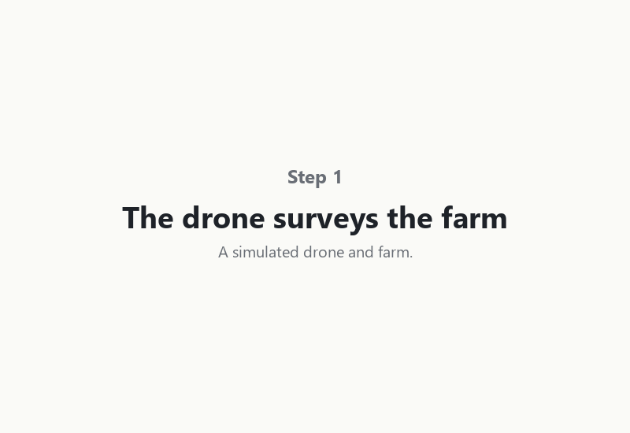

**Step 2: counting the cows in the photos.** This one uses two real photos from a survey flight over a French farm, from a public dataset.

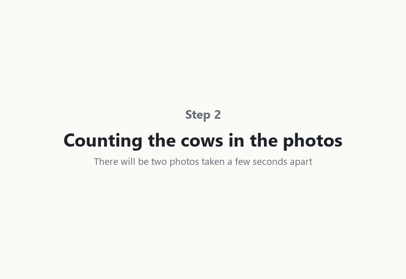

## Results at a glance

I set seven targets at the start, before the main work began (`configs/specs.yaml`). At the end I scored the finished system once on data kept aside for that: a farm from the public dataset that was never used for training or tuning, plus simulated farms and flights that had never been run. A script fills in this table from `results/`.

<!-- scorecard:start -->
| Target | Measured on | Target value | Result | |
|---|---|---|---|---|
| S1 Find cattle in a photo | held-back farm | at least 80% found and 80% of marks correct | 69% found, 74% of marks correct | Not met |
| S2 Count each photo, with a range | held-back farm | off by at most 0.45 animals per photo; 90% range holds the true count on 85% to 95% of photos | off by 2.2 (photos of about 22); holds 79% | Not met |
| S3 Count a whole flight | 20 hand-checked flights | off by at most 15% on average | off by 25% | Not met |
| S4 Alert when animals are missing | 4,000 held-back simulated farms | at most 1.5 false alarms per 100 checks; at least 65% of losses of 5+ caught | 1.6 false alarms; 46% caught | Not met |
| S5 Fly a full mission | simulation, automated checks | survey, count and dashboard run end to end in an automated test | passes in GitHub Actions; 16 of 16 overnight missions passed | Met |
| S6 Farmers can use the dashboard | 5 non-technical testers | each tester spots the urgent camp in 10 s and acts on an alert alone | not tested yet | Not yet tested |
| S7 Spot herds during the flight | held-back farm | at least 95% of herds found, 85% kept as one group | 52% found, 42% kept as one group; speed on the drone not measured | Not met |
<!-- scorecard:end -->

So far only the simulated mission meets its target. Most of the rest comes back to one problem: on a farm it hasn't seen, the detector misses too many cattle. When I give the counting and alert steps perfect detections they get close to their targets, so I don't think the fix lies in those steps. The sections below go through each result.

## How it works

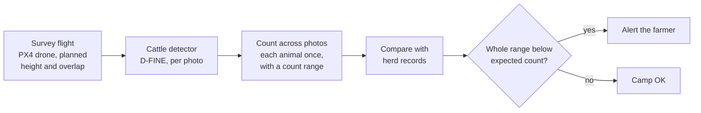

| Part | What it does | Where |
|---|---|---|
| Detector | Finds cattle in each drone photo | `gpu/`, `python/herdsight/detect/` |
| Counting | Links the same animal across overlapping photos and gives each flight a count range | `python/herdsight/count/`, `core/` (C++) |
| Herd records and alerts | Keeps track of how many animals each camp should have and decides when to alert | `python/herdsight/herd/` |
| Drone mission | Plans and flies the survey with safety checks, in PX4 and Gazebo simulation | `ros2/`, `sim/` |
| Farmer dashboard | Shows the results in plain language on a phone (working prototype) | `dashboard/`, `python/herdsight/dashboard/` |

## Progress

| Phase | | Status |
|---|---|---|
| 0 | Setup: code structure, automated checks, C++ core | Done |
| 1 | Data audit, fair splits, baselines, fixed targets | Done |
| 2 | Cattle detector | Final models chosen and tested. Detection on new farms is the main open problem |
| 3 | Counting across photos | Done, and rerun with the final detector |
| 4 | Herd records and alerts | Done, and refitted to the final detector's counting error |
| 5 | Simulated drone mission | Runs end to end in automated tests. GPS-loss return and night counting are still in progress |
| 6 | Farmer dashboard | Prototype built. The test with five people is still to do |
| 7 | Final test and write-up | Each test set run once. Write-up in progress |

## Results

### 1. Finding cattle in a photo (public data)

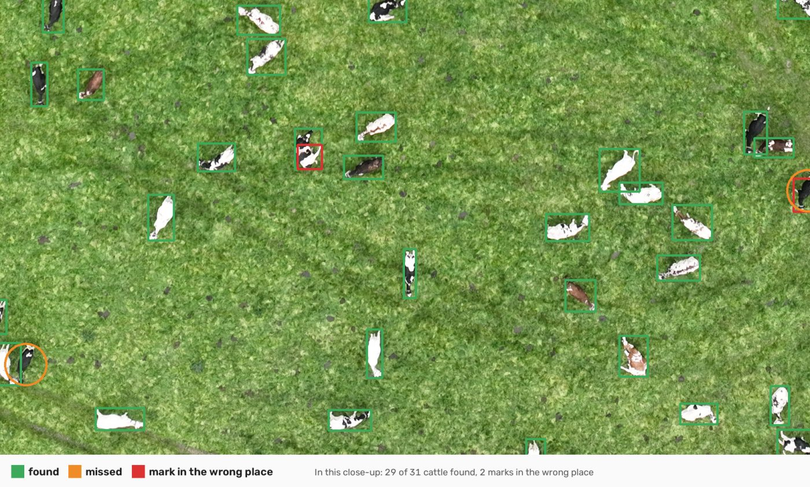

*What the detector sees, on the farm it had never seen before. Green boxes are cows it found. This part of the photo went well: 29 of 31 found.*


I trained and scored the detector on the public ICAERUS drone dataset, which has 1,323 photos and 3,392 cattle from three French farms. On survey days it didn't train on, it finds 73% of the cattle. On a farm it never saw at all, that falls to 55%.

That drop is the biggest accuracy problem in the project. Most of the cattle it misses on a new farm have dark coats or are standing in tight groups. I tried two training changes aimed at exactly this, first harder augmentation and then more dark coats and tight groups, and neither did better than the reference model on unseen farms (`docs/decisions.md`, D-49 and D-50).

### 2. Learning a new farm from its own photos (public data)


Because the detector struggles on farms it hasn't seen, the plan is to start each farm from the general model, teach it with labelled photos from that farm's first few surveys, and then check it on the farm's later surveys. I tried this on two public farms. On Jalogny, the share of cattle found went up from 68% with none of its photos to 76% with 168. On Mauron, which was scored in a different season, it went from 53% to 68% with 200 photos.

Both farms improved as the detector saw more of their photos, but neither reached the level I set before the runs (80% found and 80% of marks correct), so I can't claim it. Giving it all 447 of Mauron's photos didn't help any further (66% found). Past a couple of hundred photos from the same days, it stopped improving. My guess is that photos from more days and seasons would matter more than simply more photos, and that is the next thing I want to test. It's also only two farms and one random draw of photos, so I'd treat this as an early sign rather than a firm result.

### 3. The final test on a farm held back from the start (public data)

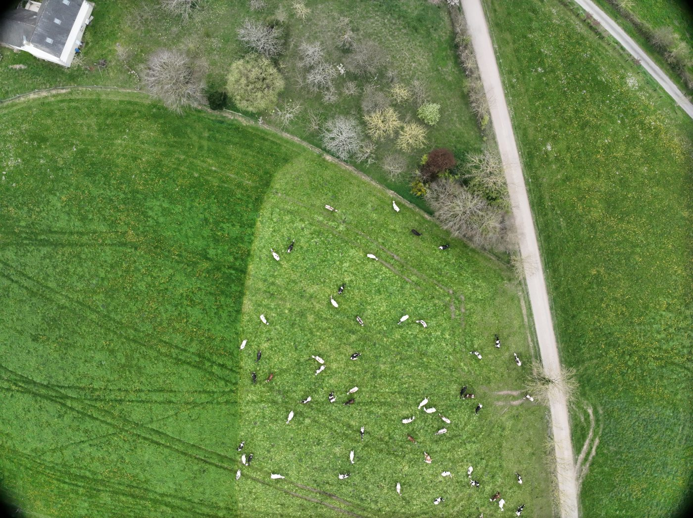

*A survey photo from the public dataset: one camp, a herd of black-and-white cows, and the hedges, trees and farm track around them. This is the farm that was kept back for the final test.*

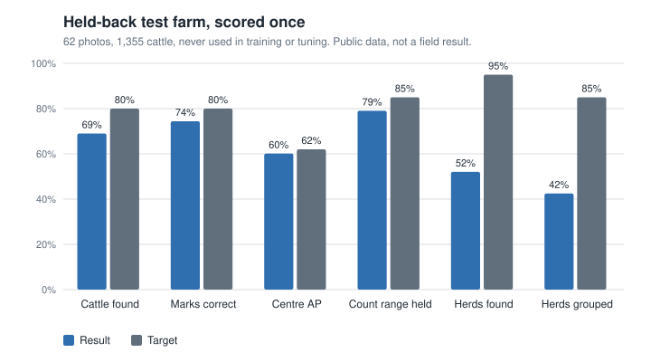

Before any work began, I set one farm in the public data aside and never used it for training or tuning. At the end I froze the final models and settings and scored that farm once: 62 photos with 1,355 cattle. The final detector found 69% of the cattle, and 74% of what it marked were actually cattle. The target was 80% for both. That lands between how it did on farms it had seen (73%) and on a farm left out of training (55%), which is roughly what I expected. These count as misses, and I didn't rerun the test to try to improve them.

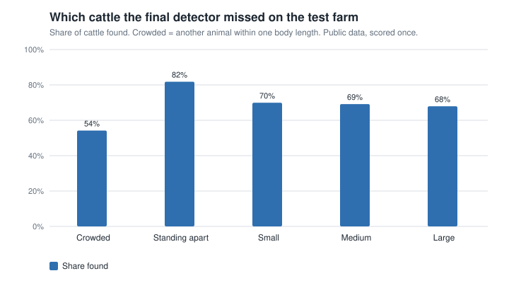

Most of the misses come down to crowding. When an animal stood within a body length of another, the detector found it 54% of the time. When it stood apart, it found it 82% of the time. How big the animal looked in the photo made almost no difference. Three quarters of the wrong marks were right next to a real animal, which suggests it was splitting one animal into two or merging two into one.

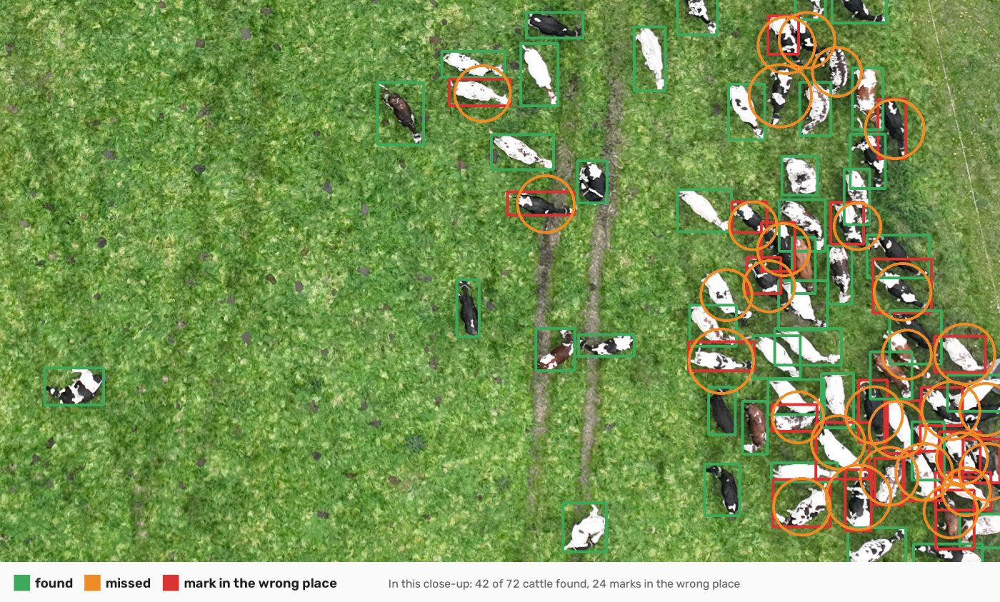

*The worst photo on the test farm. Out in the open the detector does fine, but in the tight bunch on the right it loses track: boxes cover two cows at once or sit between them, so only 42 of 72 cows in this view count as found.*

The photos on this farm are much more crowded than the ones it learned from: about 22 cattle each, compared with about 3. The count for each photo was off by 2.2 animals on average, against a target of 0.45. For photos with 20 or more animals that is under 5%. Each count also comes with a likely range, and that range held the true count on 79% of photos when the target was at least 85%. I think that's because the ranges were fitted on sparse photos. Afterwards I tried ranges that get wider as the count grows, checked on the training data only, but they came out too wide to be any use (D-55). The small onboard model, which is meant to spot herds during the flight, found 52% of the herds on this farm. In earlier tests it found 99%. Again, the animals were standing close together.

### 4. Counting a whole flight (public data)

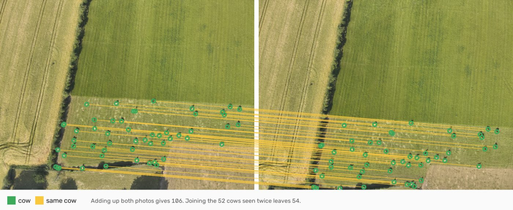

*Two photos taken two seconds apart on one flight. Most cows appear in both, so adding the photos up gives 106. Joining each cow to itself across the two photos (yellow lines, checked by hand) leaves 54 different animals. Counting across photos means doing this for a whole flight.*

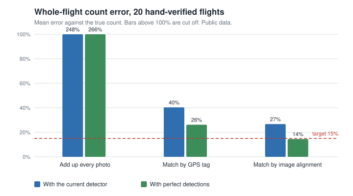

These are 20 flights where I checked the true counts by hand. If you just add up the animals in every photo, you overcount by about 250%, because the same animals show up in photo after photo. Matching animals between photos by lining the images up brings the error down to 27%. The final method also weighs how likely two detections are to be the same animal, and that brings it to 25%. The target is 15%. With perfect detections, the same method gets to 12.5%, so the matching works and most of the remaining error comes from the detector.

### 5. Deciding when to alert (simulation)

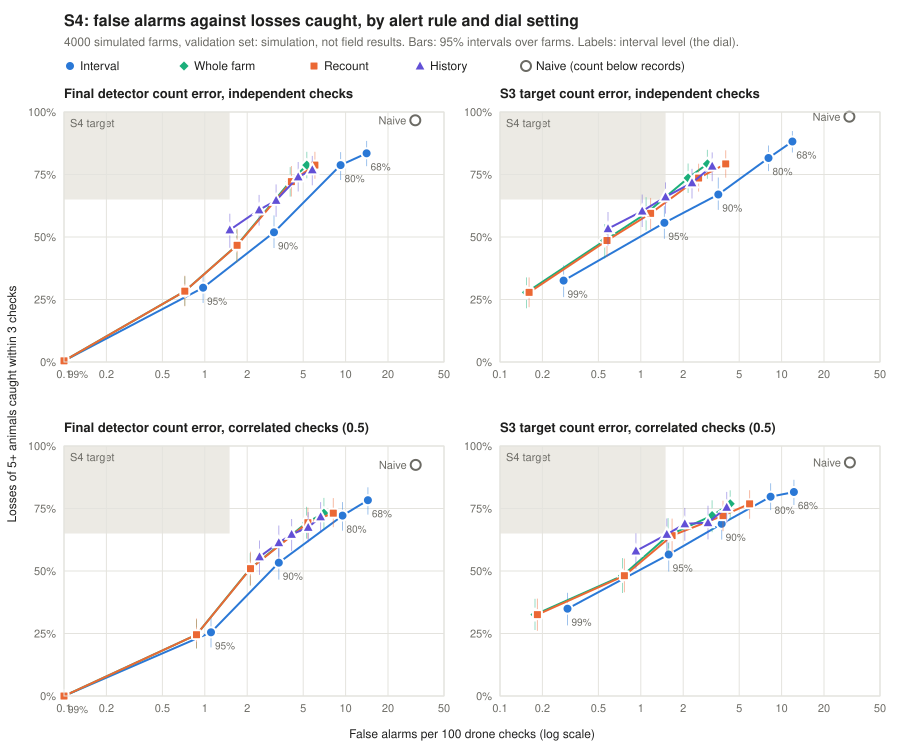

Every count comes with a range, and HerdSight only alerts when the whole range sits below the number of animals the camp should have. I tried several alert rules on 4,000 simulated farms with losses, animals moved between camps, and mistakes in the records, and measured how many false alarms each rule raised against how many real losses it caught. The chart shows each rule at each setting of the alert dial. The shaded box is the target.

With the final detector's counting error, none of the rules reaches the box. I then ran a separate set of 4,000 simulated farms once, kept aside for this test. The standard rule raised 1.6 false alarms per 100 surveys and caught 46% of losses of five or more animals. The target was at most 1.5 false alarms and at least 65% caught. If counting reached its own target, the same farms would give 1.2 false alarms and 64% caught, still just short. So improving the alerts mostly means improving the counts, rather than changing the rule.

### 6. Returning home after GPS loss (simulation)


When a drone loses GPS, the autopilot no longer knows where it is. It comes down "blind" and the wind carries it away. In simulation that put it about 200 m from where it took off in calm air, and 900 m away in a 5 m/s wind. To deal with this, HerdSight saves reference frames from its downward camera while GPS is still working. Once GPS is gone, it matches each new frame against those references, works out where it is, and hands that position to the autopilot so it can fly home.


The first chart shows every valid test flight over six rounds of testing. For each round I wrote the pass rule down before flying. The camera return has landed within 0.3 m of its take-off point several times, in calm air and in a 5 m/s wind, but it isn't reliable yet: only 3 of 12 flights passed. In the last round, on a world it hadn't flown before, it passed in a 5 m/s wind and landed 0.3 m away. In calm air, oddly, it lost track of its position close to the ground, fell back to a blind descent, and landed 11 m away. In a 10 m/s wind it landed 0.2 m away, but its position errors on the way home went past the limits. The camera is fixed to the drone's body, so when the drone leans hard into the wind the camera sees the ground at an angle. I think a stabilised camera would fix most of this.

### 7. Counting at night with a thermal camera (simulation)


This is a simulated thermal camera at night. I added patches of warmer and cooler ground, some blur and sensor noise to make it less clean. At 40 m, counting the warm shapes gets within 5% of the true count, about 0.5 animals off per frame. Add rocks still warm from the day's sun and it overcounts by 8.9%, which is inside the 10% limit. The simulated cattle are just blocks at fixed temperatures, though. This shows the idea can work, but it tells me nothing yet about how it would do on real animals.

### 8. The full mission, and the farmer's dashboard (simulation, and a prototype with made-up data)

<p>
  
  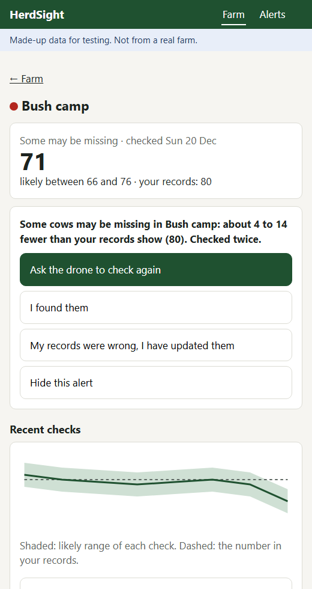
</p>

The whole chain works in simulation. The drone plans and flies the survey in PX4 and Gazebo, the photos are counted at home base, and the result shows up on the dashboard. This runs as an automated test in GitHub Actions and passes. I also ran 16 overnight simulated missions over different worlds, and 16 of 16 passed all their checks.

The dashboard is built for a phone. The first line tells you whether any camp needs attention, with a coloured map of the camps and a list that puts the urgent ones first. Each camp shows its count, the likely range and what the records say, with a short plain-English message and big buttons for dealing with an alert. It copes with a weak signal too. The last results stay on the phone, and anything you tap is sent once the signal comes back. It's a first version and I haven't yet tested it with the five non-technical people I plan to. The screenshots use a made-up farm, and the page says so.

## How the work is done

- Before each experiment I write down what I expect to happen and what counts as a pass (`docs/hypotheses.md`). If a result misses, I report it as a miss.
- I log every decision with the options I considered, the evidence, and the easier option I turned down. There are 58 so far (`docs/decisions.md`).
- The targets were set before the main work began. One farm, and separate sets of simulated farms and flights, were kept aside for one final test each (`docs/plans/phase7-final-test.md`). The scripts won't run a test set a second time.
- Scripts build the headline numbers, the charts and the results table from `results/` (for this page, `scripts/make_readme_figures.py`). A test checks that every result number on this page can be traced back to them (`scripts/check_readme_numbers.py`).
- What the system can't do is listed in `docs/limitations.md`.

## What comes next

1. Get the detector working better on new farms, starting with cattle standing close together. I also want to teach it each farm from photos taken across several days and seasons. This is what's holding back the counting and the alerts.
2. Test the dashboard with five people who aren't technical, and improve it based on what they find.
3. Make the camera return reliable, in calm air as well as in wind.

## Repository layout

| Folder | What's in it |
|---|---|
| `docs/` | Decision log, hypotheses, data notes, open questions, limitations, figures, and one plan per piece of work (`docs/plans/`) |
| `configs/` | Settings, each with a cited source |
| `core/` | C++ library: geometry, matching, count intervals (with Python bindings) |
| `python/herdsight/` | Python package: data loading, detection, counting, alerts, evaluation, simulation tools, dashboard backend |
| `ros2/` | ROS 2 packages that fly the mission |
| `sim/` | Gazebo worlds, cattle models, the herd movement model and simulated flight tools |
| `dashboard/` | Farmer dashboard pages, data schema and plain-language glossary |
| `scripts/` | Data inventory and splits, baselines, studies, freezing settings, filling docs from results |
| `gpu/` | Training and scoring jobs for cloud GPUs (Kaggle and rented GPUs) |
| `results/` | Results written by scripts (never edited by hand) |
| `tests/` | Automated tests |

Datasets and model weights aren't stored in this repository. `docs/data.md` explains where they come from.

## Development

You need Python 3.12 or later.

```bash
python -m venv .venv
.venv/bin/python -m pip install -r requirements-lock.txt   # Windows: .venv\Scripts\python
.venv/bin/python -m pip install -e . --no-deps
.venv/bin/pytest
```

The C++ core (`core/`) builds on Linux (Ubuntu 24.04, either natively or in WSL) with CMake, Ninja, Eigen and GoogleTest:

```bash
sudo apt install build-essential cmake ninja-build libeigen3-dev libgtest-dev
scripts/build_core.sh            # sanitizer build + tests, then the Python module
HERDSIGHT_REQUIRE_CORE=1 pytest  # includes the C++/Python parity tests
```

The simulated mission runs in a Docker image with PX4, Gazebo and ROS 2 (`sim/docker/`). Large files (datasets, weights, run outputs) are kept outside the repository, in the folder named by the `HERDSIGHT_STORAGE` environment variable.

To try the dashboard with the made-up farm, run `python -m herdsight.dashboard.server --db demo.sqlite --mock` and open `http://127.0.0.1:8080/`.

## Data and acknowledgements

- Drone cattle images: ICAERUS grazing cows v2, Institut de l'Elevage, Zenodo [10.5281/zenodo.11048412](https://doi.org/10.5281/zenodo.11048412) (CC BY 4.0). The photos on this page come from it, with HerdSight's marks drawn on by `scripts/make_readme_photos.py`.
- Simulated ground imagery: IGN BD ORTHO (Licence Ouverte / Etalab 2.0).
- Detector: D-FINE (Apache-2.0). The full list of models and weights is in `docs/licences.md`, and the data sources are in `docs/data.md`.

## Licence

Copyright (c) 2026 Luke Andrew. All rights reserved. See `LICENSE`.
