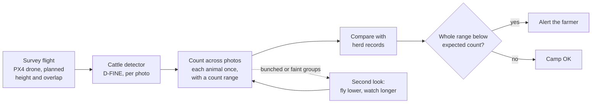
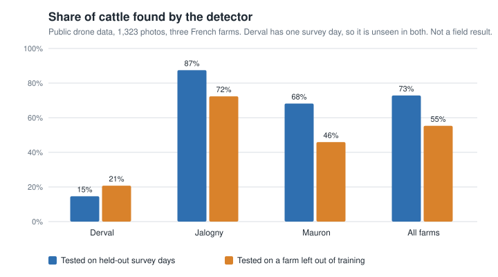
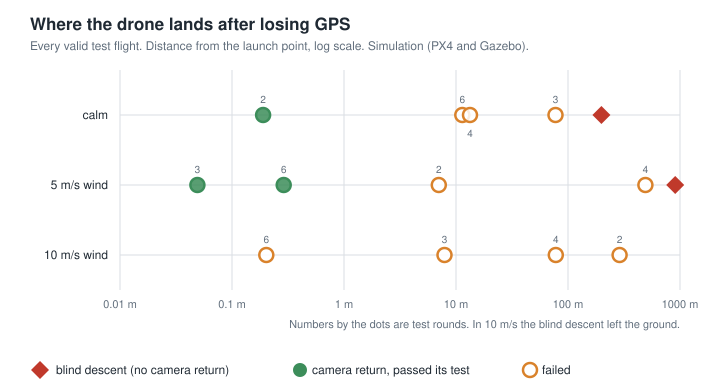
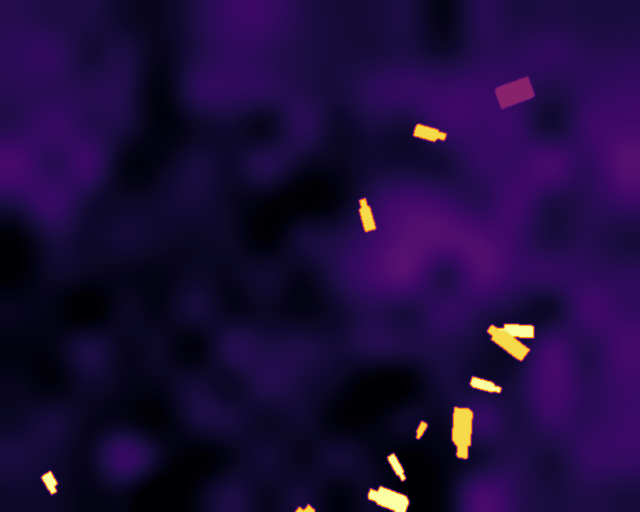

# HerdSight

**Drone-based cattle counting that tells a farmer when animals may be missing.**

HerdSight flies a survey over each camp (paddock), counts the cattle without counting the same animal twice, compares the count with the farm's herd records, and raises an alert only when animals are likely to be missing. The aim is to help farmers detect stock theft and straying early.

> **Status: work in progress (about 55% of planned tasks complete).**
> Nothing here has been flown on a real farm yet. Every result below comes from **public drone data** or **simulation** and is labelled as such. None is a field result.

---

## How it works



| Part | What it does | Where |
|---|---|---|
| Detector | Finds cattle in each drone photo | `gpu/`, `python/herdsight/detect/` |
| Counting | Links the same animal across overlapping photos and gives each flight a count range | `python/herdsight/count/`, `core/` (C++) |
| Herd records and alerts | Tracks expected animals per camp and decides when to alert | `python/herdsight/` |
| Drone mission | Plans and flies the survey with safety checks, in PX4 and Gazebo simulation | `ros2/`, `sim/` |
| Farmer dashboard | Plain-language results on a phone | `dashboard/` (not built yet) |

## Progress

| Phase | | Status |
|---|---|---|
| 0 | Setup: code structure, automated checks, C++ core | Done |
| 1 | Data audit, fair splits, baselines, frozen targets | Done |
| 2 | Cattle detector | Mostly done; final onboard model training |
| 3 | Counting across photos | Method chosen; rerun with the final detector |
| 4 | Herd records and alerts | Done; refit with final accuracy |
| 5 | Simulated drone mission | Mission and safety checks fly; GPS-loss return and night (thermal) work in progress |
| 6 | Farmer dashboard | Not started |
| 7 | Final test on the held-back farm and write-up | Not started |

## Results so far

### 1. Finding cattle in a photo (public data)



Trained and scored on the public ICAERUS drone dataset (1,323 photos, 3,392 cattle, three French farms). The detector finds **73%** of cattle when tested on held-out survey days, but **55%** on a farm it never saw in training. That gap is the main accuracy problem. Most missed animals on new farms are dark-coated or tightly bunched; two training changes aimed at this (harder augmentation, and darker coats with tight groups) did not beat the reference on unseen farms (`docs/decisions.md`, D-49 and D-50). The plan now is a *second look*: flying lower and watching longer over uncertain groups.

### 2. Counting a whole flight (public data)


On 20 hand-verified flights, adding up every photo overcounts badly (about 250%) because the same animals appear in several photos. Matching animals by image alignment brings the error to **27%**. With perfect detections the same method reaches **14%**, under the 15% target, so the counting method works and the detector is now the limit.

### 3. Alerts that stay quiet unless it matters (simulation)


Each count carries a range, and an alert is raised only when the whole range falls below the expected herd. On 4,000 simulated farms with losses, moves and record errors, the trade-off between false alarms and losses caught is measured for each rule. With today's count error the target is not yet met; with the target count error, a rule that uses each camp's survey history meets it.

### 4. Getting home safely after losing GPS (simulation)



With no GPS, the autopilot descends "blind" and the wind carries the drone away: about 200 m in calm air and 900 m in a 5 m/s wind. HerdSight keeps reference frames from its downward camera while GPS is good, and after GPS is lost it matches live frames to them and gives the autopilot that position so it can fly home.


In calm air it landed **0.2 m** from the launch point. In a 5 m/s wind it landed **7 m** away, but position errors on the way were above the limits set before the test, so that flight is counted as a fail. Strong wind (10 m/s) is not yet reliable. Work in progress.

### 5. Counting at night with a thermal camera (simulation)



A simulated thermal camera at night, with ground temperature patches, blur and sensor noise. At 40 m, counting warm regions is within **5%** of the true count (0.5 animals per frame off on average), and stays within the 10% limit with warm rocks added. The animals are simple shapes at set temperatures, so this shows the method works in principle; it is not an accuracy claim.

## How the work is done

- **Rules before results.** Hypotheses and pass rules are written down before each experiment runs (`docs/hypotheses.md`); results that fail are reported as failures.
- **Every decision recorded.** About 50 decisions so far, each with the options, evidence and the easy option rejected (`docs/decisions.md`).
- **Frozen targets and a held-back test farm.** Targets were fixed before the main work; one farm is kept untouched for a single final test (Phase 7).
- **Numbers from scripts.** Headline numbers and figures are produced from `results/` by scripts (`scripts/make_readme_figures.py`), never typed by hand.
- **Limitations stated plainly** (`docs/limitations.md`).

## What comes next

1. Finish the onboard detector and choose the final model; rerun counting and alerts with it.
2. Make the GPS-loss camera return reliable in wind; finish the night (thermal) and second-look missions.
3. Run the mission tests automatically on every change, plus a nightly many-seed run.
4. Build the farmer dashboard and test it with five non-technical users.
5. Run the held-back test farm once, freeze everything and write up the results honestly.
6. Then: real-drone and farm trials, with a go/no-go gate.

## Repository layout

| Folder | What's in it |
|---|---|
| `docs/` | Decision log, hypotheses, data notes, open questions, limitations, figures, and one plan per piece of work (`docs/plans/`) |
| `configs/` | Settings, each with a cited source |
| `core/` | C++ library: geometry, matching, count intervals (with Python bindings) |
| `python/herdsight/` | Python package: data loading, detection, counting, alerts, evaluation, simulation tools |
| `ros2/` | ROS 2 packages that fly the mission |
| `sim/` | Gazebo worlds, cattle models, the herd movement model and simulated flight tools |
| `dashboard/` | Farmer dashboard (to be built) and its plain-language glossary |
| `scripts/` | Data inventory and splits, baselines, studies, freezing settings, filling docs from results |
| `gpu/` | Training and scoring jobs for cloud GPUs (Kaggle and rented GPUs) |
| `results/` | Machine-written results (never edited by hand) |
| `tests/` | Automated tests |

Datasets and model weights are not stored in this repository; `docs/data.md` explains where they come from.

## Development

Python 3.12 or later.

```bash
python -m venv .venv
.venv/bin/python -m pip install -r requirements-lock.txt   # Windows: .venv\Scripts\python
.venv/bin/python -m pip install -e . --no-deps
.venv/bin/pytest
```

The C++ core (`core/`) builds on Linux (Ubuntu 24.04, natively or in WSL) with CMake, Ninja, Eigen and GoogleTest:

```bash
sudo apt install build-essential cmake ninja-build libeigen3-dev libgtest-dev
scripts/build_core.sh            # sanitizer build + tests, then the Python module
HERDSIGHT_REQUIRE_CORE=1 pytest  # includes the C++/Python parity tests
```

The simulated mission runs in a Docker image with PX4, Gazebo and ROS 2 (`sim/docker/`). Large files (datasets, weights, run outputs) live outside the repository, in the folder named by the `HERDSIGHT_STORAGE` environment variable.

## Data and acknowledgements

- Drone cattle images: ICAERUS grazing cows v2, Institut de l'Elevage, Zenodo [10.5281/zenodo.11048412](https://doi.org/10.5281/zenodo.11048412) (CC BY 4.0).
- Simulated ground imagery: IGN BD ORTHO (Licence Ouverte / Etalab 2.0).
- Detector: D-FINE (Apache-2.0). Full register of models and weights: `docs/licences.md`; data: `docs/data.md`.

## Licence

Copyright (c) 2026 Luke Andrew. All rights reserved. See `LICENSE`.
